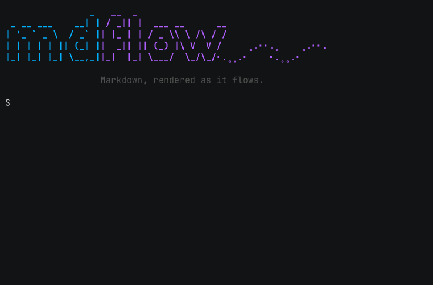

# mdflow - True Streaming Markdown-to-ANSI Renderer

**mdflow is a true streaming Markdown-to-ANSI renderer for LLM output.** It
formats Markdown as it arrives, before the response is complete, without
waiting for the full input or reparsing everything received so far.

```sh
your-llm-command | mdflow
```

Built in C with a reworked [MD4C](https://github.com/mity/md4c) parser, mdflow
is a lightweight CLI and embeddable library.

### See it in action



> [!NOTE]
> This is `cjccjj/mdflow`, a native C Markdown-to-terminal renderer. It is not
> related to similarly named Markdown workflow or agent packages.

---

## Why mdflow

- **Live output:** see formatted Markdown while an LLM response is still arriving.
- **Markdown support:** CommonMark tested against 652 examples, plus documented GFM features.
- **Fast and lightweight:** 0.55 s and 2.2 MB peak RAM for the 10 MB benchmark input.
- **Easy to embed:** a native C CLI and libc-only library.

### mdflow vs. Streamdown, mdcat, and Glow

Compare mdflow with Streamdown, mdcat, and Glow on streaming, Markdown support, speed, memory, and binary size.

|             |             | <ins> mdflow </ins> | streamdown | mdcat | glow (glamour) |  
| :---------- | :---------- | :-----------------: | :--------: | :---: | :-------------: |  
| Capabilities | Streaming | ✅ | ✅ | ❌ | ❌ |  
|              | Buffering | Single line | Single line | Whole doc | Whole doc |  
|              | CommonMark | ✅ Tested* | ❌ | ✅ Tested | ❌ |
|              | GFM tables | ✅ | ⚠️ Limited | ⚠️ Limited | ✅ |  
| Render time  | 1 MB input | $\color{green}{\mathsf{0.050\ s}}$ | $\mathsf{8.270\ s}$ | $\mathsf{0.450\ s}$ | $\mathsf{3.250\ s}$ |  
|              | 10 MB input | $\color{green}{\mathsf{0.550\ s}}$ | $\mathsf{82.140\ s}$ | $\mathsf{3.820\ s}$ | $\mathsf{38.150\ s}$ |  
|              | 100 MB input | $\color{green}{\mathsf{5.510\ s}}$ | - | $\mathsf{37.360\ s}$ | - |
| Peak RAM     | 1 MB input | $\color{green}{\mathsf{2.2\ MB}}$ | $\mathsf{22.4\ MB}$ | $\mathsf{48.7\ MB}$ | $\mathsf{198.0\ MB}$ |  
|              | 10 MB input | $\color{green}{\mathsf{2.2\ MB}}$ | $\mathsf{22.7\ MB}$ | $\mathsf{99.4\ MB}$ | $\mathsf{2.3\ GB}$ |  
|              | 100 MB input | $\color{green}{\mathsf{2.3\ MB}}$ | - | $\mathsf{617.5\ MB}$ | - |
| Binary       | Language | C | Python | Rust | Go |  
|              | Size | $\color{green}{\mathsf{306\ KB}}$ | - | $\mathsf{11\ MB}$ | $\mathsf{18\ MB}$ |

<sub>1. See "CommonMark + GFM support, extensions, and limitations" for tested coverage and known differences.</sub><br>
<sub>2. streamdown and glow did not finish the 100 MB test within 100 seconds.</sub><br>
<sub>3. Input consisted of mixed Markdown. Performance varies by content.</sub><br>
<sub>4. Benchmarked on GitHub Actions (Ubuntu 24.04, AMD EPYC 7763, 4 vCPUs)</sub><br>
<sub>5. mdflow v0.1.2, streamdown 0.36.6, glow v3.0.0, and mdcat v2.7.1.</sub>

---

## Install

For Linux and macOS, installs to `~/.local/bin`:

```sh
curl -fsSL https://raw.githubusercontent.com/cjccjj/mdflow/main/install.sh | sh
```

Or download a binary from [Releases](https://github.com/cjccjj/mdflow/releases) (Linux x86_64/arm64, macOS arm64).

---

## Use mdflow

Pipe Markdown into mdflow - live LLM output, live logs, files, or anything that streams:

```bash
my-ai-tool "show me a markdown demo" | mdflow
cat README.md | mdflow
curl -sL https://raw.githubusercontent.com/cjccjj/mdflow/main/assets/demo.md | mdflow
```

To render a file:

```bash
mdflow < README.md
mdflow README.md
```

To quickly add Markdown rendering to your CLI tool, add this Bash function to
`~/.bashrc`:

```bash
my-ai-tool() {
  command my-ai-tool "$@" | mdflow
  local s=("${PIPESTATUS[@]}")
  return "$((s[0] ? s[0] : s[1]))" 
  }
```

Reload the configuration, and use the tool normally:

```bash
source ~/.bashrc
my-ai-tool "explain this code"
```

For paging long documents, pipe to `more` or `less -R`.

```bash
mdflow < README.md | more
```

### Options

- `-h`, `--help`: Show usage.
- `--typewriter-off`: Typewriter pacing activates only when a live, slow
  stream is detected. This forces it off.
- `--osc8-off`: OSC 8 hyperlinks are on by default. This disables them for
  terminals such as Apple Terminal.
- `--theme-term-256`: Use the TERM_256 rendering theme, which is more reliable across terminals. If omitted, the DEFAULT rendering theme is used.
- `--plain`: Select plain output mode, disabling renderer-generated SGR and
  OSC 8 sequences.

---

## True streaming

mdflow starts rendering while input is still arriving. It does not wait for
EOF, keep the whole document in memory, or repeatedly reprocess everything
received so far. That makes it a natural fit for live LLM output and other
streaming Markdown sources.

## Features

- **CommonMark + GFM support** - tables, strikethrough, task lists, autolinks, footnotes, and admonitions, with known differences and streaming limitations documented below.
- **Extras** - highlights.
- **Tables** - box-drawing borders, alignment, automatic layout, and wrapping that preserves styling.
- **Unicode-correct** - tested with CJK and emoji.
- **Syntax highlighting** - simplified, generic highlighting using five styles, applied to code blocks in major programming languages.
- **Inline HTML** - tags and entities styled for the terminal, with comments hidden.
- **HTML blocks** - raw HTML scanned and styled, entities decoded, comments hidden, and Markdown inside is left literal.
- **Clickable links** - links, autolinks, and emails are OSC 8 terminal hyperlinks.
- **Color themes** - a default theme that respects the terminal's local color palette, a TERM_256 theme that uses a more stable 256-color palette, and a plain mode that disables ANSI styling.

### CommonMark + GFM support, extensions, and limitations

This section describes mdflow's current level of Markdown support and its known differences. It is not a claim of full conformance. CommonMark and GFM define expected HTML output in their examples. This section only addresses the parser, not mdflow's ANSI renderer or its terminal presentation.

mdflow is tested against all 652 CommonMark specification examples and the GFM features listed above. The complete example set is included in the test suite. MD4C is fully CommonMark-compliant; mdflow's parser produces output identical to MD4C for all examples except those involving a limitation documented below.

### Streaming limitations

A proper live Markdown generator already avoids features that depend on future input. In static documents, the practical impact remains small.

#### Could match with additional buffering, but mdflow chooses not to

| Feature | mdflow behavior | Practical impact |
| :------ | :-------------- | :--------------- |
| Tight/loose lists | The first list item may retain tight. | No visible difference in the terminal. |
| Multi-line Setext headings | Only the last line becomes a heading. | Affects only uncommon multi-line Setext headings. |

#### Cannot be fully streamed

| Feature | mdflow behavior | Practical impact |
| :------ | :-------------- | :--------------- |
| Reference links | Reference shown immediately without resolving definition, and definitions appear at the end. | Rare in live Markdown. Not fully functional in a terminal anyway. No content is lost. |
| Footnotes | Footnote reference shown immediately without validating definition. | Rare in live Markdown. No content is lost. |

### Other notes

- **Syntax highlighting** - current highlighting is lightweight and generic, rather than language-specific.
- **No pager or TUI** - mdflow renders; scrolling is left to `more` or `less -R`.
- **Customization** - two built-in themes and one fixed configuration object are exposed; user-defined themes and additional feature flags are not exposed.

More: [streaming Markdown renderer](docs/streaming-markdown-renderer.md) |
[FAQ](docs/markdown-renderer-faq.md) |
[LLM terminal recipes](docs/llm-markdown-terminal.md)

---

## Development

### Library

mdflow is also a small C library with a small libc-only API:

```c
#include "mdflow.h"

mdflow_config_t config;
mdflow_t* mf;

config.theme = MDFLOW_THEME_DEFAULT;
config.plain = 1;
config.osc8 = 1;
mf = mdflow_open(80, &config, my_output_callback, my_userdata);
mdflow_write(mf, "# Hello\n", 8);
mdflow_close(mf);
```

### Build

```sh
cmake -S . -B build
cmake --build build
```

Building requires only a C compiler and CMake. GCC and Clang builds enable `-Wall`, `-Wextra`, and `-Wshadow`.

### Architecture

```text
stdin -> parser (streaming) -> renderer (streaming) -> stdout
```

Two components, both streaming, bundled into one library - no AST, no document buffer.

**Parser (MD4CS)** - [MD4C](https://github.com/mity/md4c) is a fast SAX-like Markdown parser with a flat-buffer design, though it still buffers in full and fires all callbacks at the end, because many features depend on input that has not arrived yet.  
When analyzed feature by feature, some require only one line of lookahead; some require unbounded lookahead but style can be determined earlier. mdflow's parser MD4CS, builds on top of MD4C, reconstructs the features that require handling to enable true streaming. It can thus emit callbacks in the first pass and free memory immediately.

**Renderer (md4cs-ansi)** - maps parser callbacks to styled terminal output.

**Sub-modules:**

- `highlight.c` - single-pass lightweight code highlighting, derived from [microlight](https://github.com/asvd/microlight) (MIT)
- `html.c` - HTML tag/entity scanner that styles raw HTML
- tables - box-drawing layout that redraws when column widths change mid-stream

### Acknowledgments

- [MD4C](https://github.com/mity/md4c) by Martin Mitas (MIT) - the parser mdflow is built on.
- [microlight](https://github.com/asvd/microlight) by asvd (MIT) - the code highlighter is derived from it.

### License

MIT. See [LICENSE](LICENSE) and the license comments in the source file headers.
